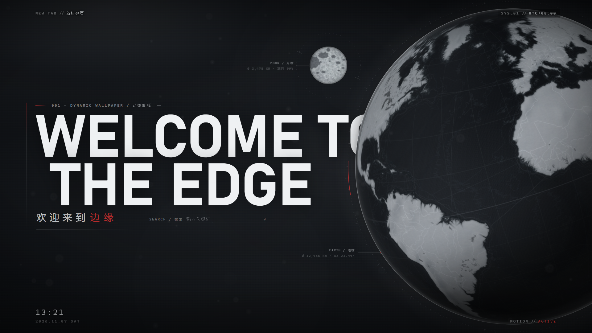
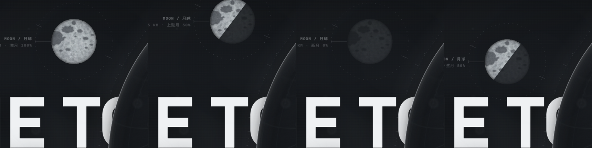
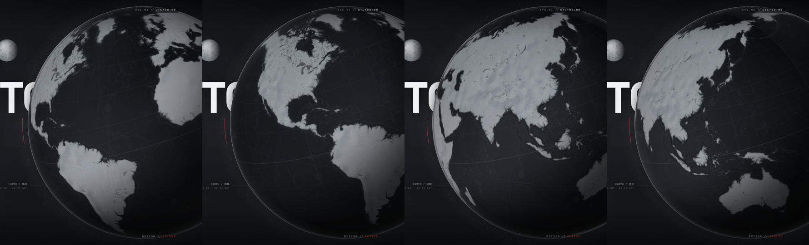

# WELCOME TO THE EDGE · 边缘

一个用 Manifest V3 实现的自定义新标签页（Edge / Chrome 均可加载）：**灰黑渐变背景 + 缓慢自转的 2D 地球 + 带月相与公转的月球 + 景深尘埃**，全屏、无滚动条、零第三方库、零远程资源。



## 特性

- **地球**
  - 真实地理数据：Natural Earth 1:10m 海岸线（5,000+ 多边形 / 2,800+ 小岛）、1,400+ 湖泊、670+ 河流、国境线、4 级海洋深度分带
  - WebGL 球面渲染：球面投影、贴图采样、平行光照全部交给 GPU，每帧约 0.08ms
  - 运行时生成 4096×2048 等距圆柱贴图：水彩湿边、纸感颗粒、大陆架浅海晕、地形起伏与等高线（公开高程点合成）
  - 缓慢自转；被画面右侧裁切，形成"星球升起"的构图
- **月球**
  - 按真实近地面坐标绘制月海（风暴洋、雨海、静海、危海…）、环形山、辐射纹
  - 动态月相：受光半圆 + 明暗交界椭圆实时裁剪，240 秒一个完整周期
  - 潮汐锁定：始终同一面朝向地球；沿轨道缓慢移动
  - 标注实时显示相位（如 `上弦月 50%`）
- **版式**
  - 巨大白色标题 `WELCOME TO THE EDGE`，位于地球图层之下，被球体裁切形成景深
  - 欢迎来到 **边缘**（血红点缀）、制图式测量刻度与标注、四角 HUD
  - 「边缘」右侧的极简搜索框：回车搜索、`/` 聚焦、`Esc` 失焦、打开即聚焦
- **无干扰 / 可访问**
  - `prefers-reduced-motion` 下完全静态（无粒子、无自转、不跑 rAF）
  - 页面隐藏时暂停 `requestAnimationFrame`，可见时恢复
  - 窗口缩放 / 显示器 DPR 变化自适应

## 预览

| 月相循环 | 四大洲视角 |
|---|---|
|  |  |

## 安装（Edge）

1. 地址栏打开 `edge://extensions/`
2. 左下角打开「**开发人员模式**」
3. 点「**加载解压缩的扩展**」，选择本项目文件夹
4. 打开新标签页即可

Chrome 同理：`chrome://extensions/` → 开发者模式 → 加载已解压的扩展程序。

> 不需要任何权限申请；只通过 `chrome_url_overrides.newtab` 覆盖新标签页。

## 使用

- 打开新标签页后搜索框自动聚焦，直接输入 + 回车即可搜索（默认 Bing，见「自定义」）
- 按 `/` 随时聚焦搜索框，`Esc` 失焦
- 地球约 5 分钟自转一周；月球 4 分钟一个完整月相周期

## 技术实现

```
newtab.html  结构：背景层 / 巨字层 / WebGL 画布 / Canvas2D 画布 / 暗角颗粒 / HUD
newtab.css   版式、渐变、标题、搜索框、EUI 适配
newtab.js    数据（内嵌）+ 贴图生成 + 渲染管线 + 动画与生命周期
```

- **双画布**：`#globe` 用 WebGL 画地球（球面重投影 + 光照 + 抖动 + 抗锯齿边），`#scene` 用 Canvas 2D 画月球、尘埃、测量刻度与标注；装饰层预渲染成一张位图，每帧只 `drawImage` 一次。
- **数据内嵌**：海岸线、湖泊、河流、国界、海深、山峰高程点全部经 Douglas–Peucker 简化后以 JS 数组内嵌（约 1.1MB），无外部数据文件、无网络请求。
- **月相**：贴图只存反照率，每帧用「受光侧半圆 + 明暗交界椭圆」路径裁剪绘制，`k = cos(φ)` 决定亮面比例，与地球同一光源方向。
- **动画**：单一 `requestAnimationFrame` 链；`visibilitychange` 暂停/恢复；`prefers-reduced-motion` 时只画一帧静态画面。

性能参考（1920×1080，headless 软件渲染）：初始化约 90–120ms，每帧 GPU 绘制 0.09ms，60 fps 上限由垂直同步决定。

## 自定义

| 想改什么 | 位置 |
|---|---|
| 自转速度 | `newtab.js` → `CONFIG.spinPerSecond`（弧度/秒，现 0.02） |
| 月相/公转周期 | `newtab.js` → `MOON_ORBIT_PERIOD`（毫秒，现 240000） |
| 月球大小/位置 | `newtab.js` → `computeLayout()` 中 `state.moonR / moonX / moonY` |
| 地球大小与裁切 | `newtab.js` → `computeLayout()` 中 `R` 与 `cx` |
| 搜索引擎 | `newtab.html` → `<form class="search" action="https://www.bing.com/search">` |
| 搜索框样式 | `newtab.css` → `.search__input` / `.search__k` |
| 国境线浓淡 | `newtab.js` → 描边 `rgba(238,243,248,0.16)` 与 `lineWidth` |
| 起飞视角 | `newtab.js` → `init()` 中 `state.spin` |

## 数据来源与许可

- 地理数据：[Natural Earth](https://www.naturalearthdata.com/) 1:10m / 1:50m（**公有领域 / Public Domain**），经简化后内嵌；山峰高程点用于生成地形起伏与等高线。
- 代码：MIT（见 [LICENSE](LICENSE)）。
- 字体：仅使用系统字体（Segoe UI / Bahnschrift / Microsoft YaHei / Consolas），不加载任何远程字体。

## 隐私

- 不收集、不上传任何数据；页面加载过程**没有任何网络请求**。
- 唯一的外部交互是：你在搜索框提交时，浏览器导航到你选择的搜索引擎。

## 已知限制

- 没有 DEM 高程栅格，山脉起伏与陆地等高线由真实山峰位置 + 分形噪声合成，属于**近似地形**，非测绘级。
- 月球相位是按画面光源方向驱动的**艺术化循环**（真实月球距地球约 60 个地球半径，画面中看不出轨道位移）。
